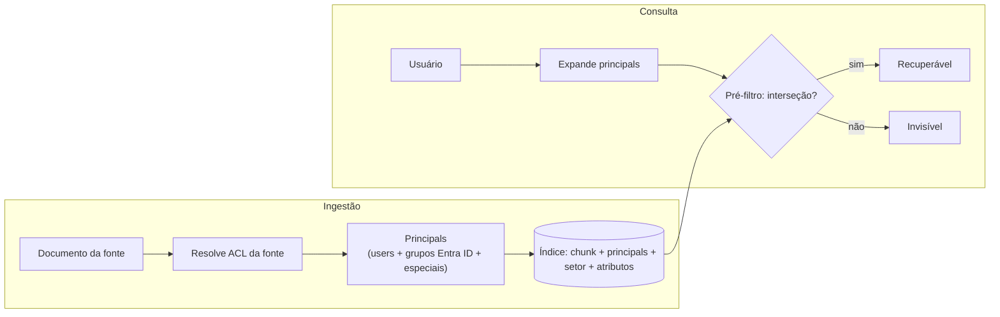

div align="center">

# 🔐 Modelagem de ACL + Esquema de metadados — Thermo Fisher

**Documento companheiro** (alinhado à arquitetura v1: Azure · M365 · Event Hubs · pré-filtro de ACL)

Detalha o item de maior risco do projeto: garantir que a permissão de cada fonte seja refletida com fidelidade **dentro** da busca e na partição do grafo, sem vazar dado entre setores — incluindo o caso regulado (blinding).

</div>

> **Premissa a validar:** o stack de fontes assumido é **M365 (SharePoint · Teams · OneDrive)** como backbone corporativo + um **repositório de conteúdo regulado** (ex.: sistema de gestão clínica/regulatória) — este último a confirmar internamente. Semânticas de permissão abaixo são conceituais; confirmar nas APIs vigentes antes de implementar.

---

## 1. Princípio central: normalizar permissões em "principals"

Cada fonte tem um modelo de permissão diferente. Em vez de interpretá-los em tempo de consulta (lento e arriscado), **normalizamos tudo na ingestão** para um modelo único:

> Todo documento, ao ser indexado, é resolvido para um **conjunto de principals** com direito de leitura. Um *principal* é um usuário, um grupo (Entra ID) ou um marcador especial (ex.: "todos do tenant", "setor X").

Na consulta, expandimos os principals do usuário (ele + seus grupos + setor) e o **pré-filtro** só deixa passar documentos cuja lista de principals intercepta a do usuário. Interseção vazia = documento invisível (falha fechada).



**Por que assim:** desacopla a complexidade das fontes do caminho quente. A consulta faz só uma operação de conjunto, aplicada **dentro** da busca ANN (pré-filtro) — ver seção 4.

---

## 2. Mapeamento por fonte

| Fonte | Unidade de permissão | Papéis típicos | Herança | Grupos | Marcador "amplo" |
|-------|----------------------|----------------|---------|--------|------------------|
| **SharePoint / OneDrive** | Site · biblioteca · item | full control, edit, read | Site → biblioteca → pasta → item | M365 Groups / grupos de segurança (Entra ID) | "todos, exceto externos" / org-wide |
| **Teams** | Canal (padrão/privado) | membro / proprietário | Arquivos herdam o SharePoint do time | Membership do time/canal (Entra ID) | Canal padrão = membros do time |
| **Repositório regulado** *(a confirmar)* | Documento · estudo · site | role-based | Por estudo/site | Grupos de função | Normalmente restrito por padrão |

**Regras de tradução (para leitura):**

- **SharePoint/OneDrive:** cada concessão `read`/`edit`/`full control` de usuário ou grupo vira principal de leitura. Herança de site→item é resolvida seguindo a cadeia; *unique permissions* (quebra de herança) são respeitadas. "Todos exceto externos" vira `tenant:all`.
- **Teams:** arquivos residem no SharePoint do time → principals = membros do time; **canal privado** = subconjunto de membros. Mensagens herdam o canal.
- **Repositório regulado:** principals por **função + estudo/site**; por padrão restrito. É onde entram os atributos de **blinding** (seção 3).

**Marcadores especiais:**

| Marcador | Significa |
|----------|-----------|
| `tenant:all` | Qualquer funcionário autenticado do tenant |
| `sector:<id>` | Todos de um setor |
| `team:<id>` | Membros de um time/canal |

---

## 3. Setor regulado: blinding e segregação por estudo (ABAC)

No setor regulado, permissão de leitura não basta — há **atributos** que barram acesso mesmo a quem tem o papel: uma equipe *blinded* não pode ver dados *unblinded* do próprio estudo.

Modelamos isso como **ABAC** sobre o documento:

- `estudo_ref` — a qual estudo o documento pertence.
- `blinding` — `blinded` | `unblinded` | `n/a`.
- `sponsor_ref` — para segregar por sponsor/cliente.

Regra de consulta (além do pré-filtro de principals): se o documento é `unblinded` e o usuário está no papel *blinded* daquele `estudo_ref`, **nega** — independentemente da relevância semântica. Falha fechada.

---

## 4. Pré-filtro: ACL dentro da busca (não depois)

A permissão entra **dentro** da busca ANN do Azure AI Search, como **metadado filtrável** replicado do banco-fonte. Pós-filtrar (buscar e depois descartar) machuca recall e pode vazar em borda.

Isso cria uma **réplica da ACL no índice**, que precisa ficar sincronizada com o PostgreSQL (fonte de verdade). O mesmo **Event Hubs** da ingestão propaga mudança de documento **e de permissão**: uma revogação entra com prioridade máxima e atualiza o metadado do índice em segundos.

> **Este é o risco nº 1 do projeto.** Se a réplica atrasar, um documento revogado continua recuperável. Mitigação: propagação por evento (não por TTL), reconciliação periódica de segurança, e teste de vazamento no critério de aceite.

---

## 5. Grupos e a armadilha da expansão

Membership resolvido do **Entra ID** (fonte dos grupos corporativos) + grupos nativos das fontes. Cache de membership com **TTL curto** (30–60 s) **e** invalidação por evento. Quem sai de um grupo perde acesso em segundos, não no próximo TTL.

---

## 6. Esquema do banco de metadados (Azure DB for PostgreSQL)

DDL inicial. Todas as consultas usam **prepared statements** (anti-SQLi). O PostgreSQL é a **fonte de verdade**; o índice (Azure AI Search) recebe a réplica dos principals para o pré-filtro.

```sql
CREATE TABLE setor (
    id    BIGINT GENERATED ALWAYS AS IDENTITY PRIMARY KEY,
    nome  TEXT NOT NULL UNIQUE
);

-- Identidade vem do Entra ID (OIDC). Senha NUNCA aqui.
CREATE TABLE usuario (
    id           BIGINT GENERATED ALWAYS AS IDENTITY PRIMARY KEY,
    sso_subject  TEXT NOT NULL UNIQUE,           -- 'sub' do token OIDC (Entra ID)
    email        TEXT NOT NULL UNIQUE,
    setor_id     BIGINT NOT NULL REFERENCES setor(id),
    ativo        BOOLEAN NOT NULL DEFAULT TRUE,
    criado_em    TIMESTAMPTZ NOT NULL DEFAULT now()
);

CREATE TABLE grupo (
    id         BIGINT GENERATED ALWAYS AS IDENTITY PRIMARY KEY,
    fonte      TEXT NOT NULL,                     -- 'entra' | 'sharepoint' | 'teams' | 'regulado'
    fonte_ref  TEXT NOT NULL,
    nome       TEXT,
    UNIQUE (fonte, fonte_ref)
);

CREATE TABLE grupo_membro (
    grupo_id    BIGINT NOT NULL REFERENCES grupo(id),
    usuario_id  BIGINT NOT NULL REFERENCES usuario(id),
    PRIMARY KEY (grupo_id, usuario_id)
);

CREATE TABLE documento (
    id            BIGINT GENERATED ALWAYS AS IDENTITY PRIMARY KEY,
    fonte         TEXT NOT NULL,                  -- 'sharepoint' | 'onedrive' | 'teams' | 'regulado'
    fonte_ref     TEXT NOT NULL,
    tipo          TEXT NOT NULL,                  -- 'tabela' | 'pdf' | 'docx' | 'imagem' | 'texto'
    setor_id      BIGINT NOT NULL REFERENCES setor(id),
    uri           TEXT,                           -- ponteiro para o Blob Storage
    -- Atributos ABAC do setor regulado (nulos fora dele):
    estudo_ref    TEXT,
    blinding      TEXT,                           -- 'blinded' | 'unblinded' | NULL
    sponsor_ref   TEXT,
    atualizado_em TIMESTAMPTZ NOT NULL,
    UNIQUE (fonte, fonte_ref)
);

-- ACL RESOLVIDA (replicada para o índice como metadado de pré-filtro)
CREATE TABLE documento_acl (
    documento_id    BIGINT NOT NULL REFERENCES documento(id) ON DELETE CASCADE,
    principal_tipo  TEXT NOT NULL,                -- 'usuario' | 'grupo' | 'especial'
    principal_ref   TEXT NOT NULL,                -- id do usuario/grupo, ou 'tenant:all'/'sector:<id>'/'team:<id>'
    PRIMARY KEY (documento_id, principal_tipo, principal_ref)
);
CREATE INDEX idx_acl_principal ON documento_acl (principal_tipo, principal_ref);

CREATE TABLE chunk (
    id            BIGINT GENERATED ALWAYS AS IDENTITY PRIMARY KEY,
    documento_id  BIGINT NOT NULL REFERENCES documento(id) ON DELETE CASCADE,
    ordem         INT NOT NULL,
    conteudo      TEXT,                           -- vetor referenciado por este id no Azure AI Search
    UNIQUE (documento_id, ordem)
);

CREATE TABLE auditoria (
    id          BIGINT GENERATED ALWAYS AS IDENTITY PRIMARY KEY,
    usuario_id  BIGINT REFERENCES usuario(id),
    pergunta    TEXT NOT NULL,
    fontes_ret  TEXT[],
    resultado   TEXT NOT NULL,                    -- 'ok' | 'nao_encontrado' | 'negado'
    criado_em   TIMESTAMPTZ NOT NULL DEFAULT now()
);
```

**Notas:** a `documento_acl` guarda a ACL **já resolvida** (herança, grupos, marcadores feitos na ingestão) e é o que se replica ao índice. `setor_id` habilita o filtro ABAC e a **partição do grafo por setor**. Os campos `estudo_ref`/`blinding`/`sponsor_ref` só se aplicam ao setor regulado. Nenhuma senha em lugar algum — identidade via `sso_subject` do Entra ID.

---

## 7. Filtro na consulta

**Caminho quente (pré-filtro no índice):** a busca no Azure AI Search já recebe o filtro de principals + atributos ABAC como parte da query vetorial — os candidatos retornados **já vêm autorizados**.

**Fonte de verdade / reconciliação (PostgreSQL):** a mesma lógica, parametrizada, para reconciliar a réplica e auditar:

```sql
--   $1 = principals[]  ex.: ['grupo:7','sector:3','tenant:all']
--   $2 = usuario_blinded_em[]  (estudos onde o usuário é blinded)
SELECT c.id, c.documento_id, c.ordem
FROM chunk c
JOIN documento d       ON d.id = c.documento_id
JOIN documento_acl acl ON acl.documento_id = d.id
WHERE (acl.principal_tipo || ':' || acl.principal_ref) = ANY ($1)
  AND NOT (d.blinding = 'unblinded' AND d.estudo_ref = ANY ($2))   -- barra unblinded p/ blinded
  AND c.id = ANY ($3);                                             -- candidatos do índice/grafo
```

---

## 8. Riscos específicos desta modelagem

- **Réplica de ACL desatualizada (nº 1):** pré-filtro depende do metadado no índice; atraso = vazamento. Propagar por Event Hubs, reconciliar, testar.
- **Herança / unique permissions (SharePoint):** quebra de herança mal resolvida abre documento além do devido. Testar overrides.
- **Blinding:** classificar errado `blinded`/`unblinded` é falha crítica de compliance. Validar com Quality/Clinical.
- **Grupo desatualizado:** TTL longo = janela indevida. TTL curto + evento.
- **Semânticas por fonte:** confirmar nas APIs reais (M365 e repositório regulado) antes de implementar.

---

<div align="center">
<sub>Companheiro da arquitetura v1. Stack de fontes e semânticas são premissas a confirmar internamente antes da implementação.</sub>
</div>
